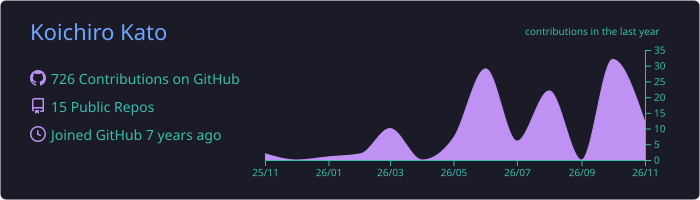
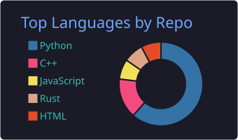
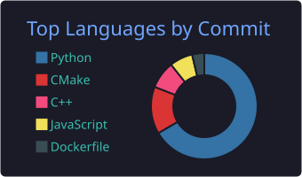
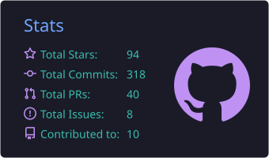
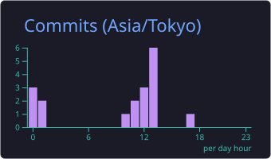

<h1 align="center">Hi there, I'm Koichiro Kato 👋</h1>

  Robotics software / ROS / Python / C++

  <a href="https://koichirokato.github.io/resume/">Resume (Japanese)</a>

<!-- All images are generated by .github/workflows/readme-stats.yml and
     published to the output branch. -->

<h3 align="center">🛠️ Tech Stack</h3>

  

<h3 align="center">📊 GitHub Stats</h3>

  

  
  

  
  

